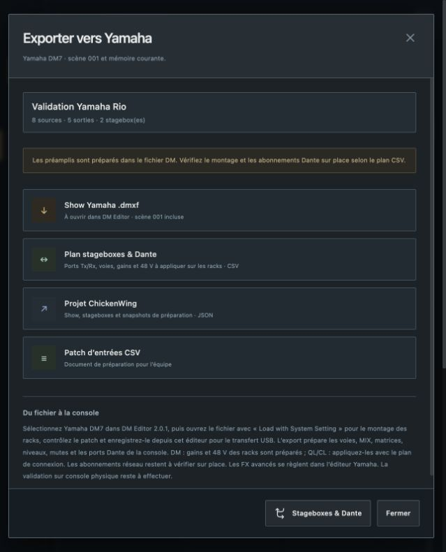

# Vérifications effectuées

- 30 tests automatisés passent : contrat snapshot.11, sources stéréo/M/S, routage interne des côtés des bus, sources partagées, contraintes physiques, conflits d’inserts, aller-retour d’un snapshot, déplacements et suppressions, parsing des patchs et préservation des paramètres inconnus.
- Dans le navigateur : création d’un show par l’assistant, import d’un PDF texte, import d’un classeur XLSX et OCR d’une image contenant un patch. Les trois sources synthétiques ont chacune produit les trois voies attendues.
- Dans le navigateur : édition d’une voie, capture et rappel d’un snapshot, sauvegarde après rechargement, préparation d’un envoi pré-fader à −12 dB, insertion d’un GEQ et téléchargement d’un fichier .snap.
- Le fichier réellement téléchargé par l’interface a été relu et contrôlé : enveloppe snapshot.11, noms de voies, source stéréo B.3–4 et indices gauche/droite du bus 2.
- Rendu contrôlé à 1440 px et 390 px ; aucun débordement horizontal global sur le petit écran. Les grands tableaux défilent dans leur propre zone.
- Bibliothèques PDF, XLSX, moteur OCR et modèles linguistiques chargés depuis le serveur local ; aucune erreur ni requête externe nécessaire pendant ces essais.
- Lanceur Python : détection d’une instance déjà ouverte vérifiée. Archive portable contrôlée ; aucun snapshot personnel de référence inclus.

## Vérifications supplémentaires de la version 1.1

- Identité de la démo migrée vers Sourd Agency - Live Session / Michel Jason / 13 décembre 2012 / Dans la haie - Blois, sans remise à zéro automatique de son patch existant.
- Remise à zéro de la démo puis annulation contrôlées dans le navigateur.
- Wizard testé avec 1 wedge, 1 IEM, 2 bus de groupe, 1 bus FX et 1 bus libre.
- Insertion d’une entrée au numéro 2 avec décalage des numéros et du patch ; renumérotation partielle des voies à partir du numéro 3 vers 10 ; annulation contrôlée.
- Insertion d’une sortie au bus 2 ; déplacement du patch de l’IEM du bus 3 d’AES50 A.3–4 vers B.9–10.
- Application rapide d’un envoi à −9 dB post-fader et accès aux détails par double-clic contrôlés. Un envoi bus de groupe vers Main 2 a aussi été appliqué ; Main 2 a été renommé et réglé à −6 dB.
- Les 65 identifiants FX ont été comparés à la liste de WING Remote Protocols 3.1.0. Dans le navigateur, Hall Reverb est bien indisponible en slot 9, Mastering peut y être chargé et Hall Reverb peut être chargé en slot 1.
- Le .snap réellement téléchargé depuis la version 1.1 a été relu : CH1 → BUS4 à −9 dB POST, BUS4 → MAIN2 à −9 dB, niveau Main 2 à −6 dB, patch IEM sur B.9–10, Mastering en FX9 et Hall en FX1, inséré sur le bus FX6.
- Les nouveaux tests couvrent aussi le déplacement d’un Main, la préservation de l’EQ d’une voie ou d’un bus déplacé depuis un snapshot importé, l’absence de réactivation d’un ancien envoi, ainsi que l’export d’une scène entièrement vide.

## Vérifications supplémentaires de la version 1.2

- 46 tests automatisés passent. Les nouveaux tests couvrent les affectations multiples DCA / mute, les 76 tranches, les noms et états de groupe, les déplacements sans anciennes affectations résiduelles, la cohérence des 340 références, la recherche et le tri des alternatives, les politiques d’alimentation, les sources partagées, les déplacements entre interfaces et les profils embarqués dans les projets.
- Dans le navigateur, sur une copie de la démo ensuite retirée : affectation de Kick In aux DCA 1 et 5 et au mute group 2 ; DCA 5 nommé DRUM FX à −6 dB ; Main LR affecté au mute group 2, nommé PAUSE et activé. Les filtres et l’affectation / retrait en masse des quatre Main ont été contrôlés.
- Le SM7dB a été essayé en bypass puis en mode préampli actif. Un passage sur USB a désactivé le phantom et signalé son alimentation en amont ; le retour sur AES50 a réappliqué la recommandation. Une BSS AR-133 a été choisie sur pile et une Radial J48 sur phantom.
- Le `.snap` réellement téléchargé depuis l’interface a été relu : phantom A.1 OFF et A.2 ON ; tags CH1 #D1 #D5 #M2, Main1 #M2 ; DCA5 DRUM FX à −6 dB ; mute group 2 PAUSE activé.
- Après rechargement de la page, les profils microphones, le choix pile et les affectations multiples étaient conservés.
- La prévisualisation d’un patch importé a affiché KM184 ON en automatique, SM58 OFF en automatique et un second KM184 OFF lorsque le document l’indiquait explicitement. Le modèle Batterie acoustique a également ajouté son KM184 avec le phantom activé.
- La recherche par modèle, l’accès à une alternative d’une autre marque et le formulaire d’ajout personnel ont été contrôlés. La recherche DI active affiche seulement les DI correspondantes.
- Rendu contrôlé à 1440 px et 390 px : aucun débordement horizontal global ; matrices dans leur zone de défilement. Les nouveaux aperçus sont chickenwing-groupes-v1.2.png et chickenwing-micros-v1.2.png.
- La base et le guide sont fournis hors ligne. Les liens fabricant s’ouvrent à la demande. Le classement de popularité est éditorial, et n’est pas présenté comme une statistique de ventes.

## Vérifications supplémentaires de la version 1.3

- 52 tests automatisés passent, dont la migration des noms / liens de catégories, le changement de groupe avec conservation des autres DCA et mute groups, le maintien d’une suppression manuelle, la sauvegarde du lien, les préfixes courts de recherche et le phantom du Samson C02 sur une source stéréo.
- Dans une copie temporaire de la démo : CH1 déplacé de Batterie / DCA1 vers Basse / DCA2 ; DCA2 renommé BASS, nom retrouvé sur la voie, dans son sélecteur de groupe et dans le filtre après rechargement.
- Recherche rapide : sélection du C02 au clic ; choix du SM58 avec Entrée (phantom OFF), puis du SM7dB avec Flèche bas et Entrée (phantom ON). Échap a annulé une recherche C02 sans modifier le SM7dB. Un libellé libre a été ajouté puis annulé, ramenant le C02 et son profil.
- L’export `.snap` réellement téléchargé a été relu : CH1 membre du DCA2, retiré du DCA1 ; nom DCA2 BASS ; nom DCA1 Batterie ; phantom A.1 actif pour le C02.
- La recherche « sm » propose huit suggestions et la navigation peut atteindre la dernière. Menu flottant vérifié dans l’inspecteur et recherche C02 accessible à 390 px, sans débordement horizontal du document. La copie de contrôle est retirée après les essais.

## Vérifications supplémentaires de la version 1.4

- Refonte visuelle CSS : rayons de 1 à 2 px pour les panneaux et contrôles, onglets encadrés, interrupteurs rectangulaires, en-têtes et grilles plus contrastés. Les voyants circulaires d’état sont conservés.
- Contrôle dans le navigateur du patch, du rack FX, de la matrice DCA, du catalogue de micros et de la fenêtre de configuration. Rayons calculés vérifiés : panneau 2 px, fenêtre 2 px, interrupteur 2 px et curseur 1 px.
- Affichage vérifié à 1280 px et 390 px ; aucun débordement horizontal du document à 390 px. L’onglet actif, les affectations DCA existantes et le nombre de références du catalogue restent cohérents. Aucune erreur console observée.
- Les règles de préparation audio et d’export ne sont pas modifiées. Les interactions de vérification n’ont pas changé les réglages du show.

## Vérifications supplémentaires de la version 1.5

- 57 tests automatisés passent. Les nouveaux contrats couvrent les groupes de couleur sans DCA dans une scène neuve et la démo, la conversion explicite, l’inclusion facultative des futures voies, les changements de groupe, la conservation des autres DCA et mute groups, le retour aux couleurs seules, les suppressions manuelles qui restent supprimées, les DCA sur mesure sur les cinq familles de tranches, le refus d’écraser un emplacement utilisé, la migration des anciennes affectations automatiques, la conservation des liens dans le projet, les renumérotations et la libération d’un DCA.
- Dans le navigateur, une copie temporaire de la démo a été utilisée. Kick In déplacé de Batterie vers Basse : aucune affectation DCA. Conversion de Basse vers DCA3 BASS sans inclusion des futures voies : trois membres, nom partagé dans le patch. DCA1 BAND créé sur mesure avec CH1, BUS15 FX Plate et Main1. Le retour de Basse à « Couleurs uniquement » a libéré DCA3 et conservé BAND et ses membres.
- Batterie convertie vers DCA2 avec inclusion des futures voies. Une nouvelle voie Perc test CH22 ajoutée dans Batterie a rejoint DCA2 automatiquement. Le lien et l’option ont été conservés après rechargement. Libérer BAND a remis DCA1 à l’état libre et conservé DCA2.
- Le `.snap` réellement téléchargé avant la libération de BAND a été relu : DCA1 BAND, DCA2 Batterie, DCA3 sans nom ; CH1 #D1 #D2, CH10 sans DCA, CH22 #D2, BUS15 et MAIN1 #D1. Les règles de conversion propres à ChickenWing sont conservées dans le projet JSON ; le format WING exporte les affectations effectives.
- Migration de la démo existante vérifiée dans le navigateur : aucun DCA configuré. La copie de contrôle a ensuite été retirée et la démo d’origine affiche 0 / 16 DCA utilisés.
- Formulaires de conversion et de création sur mesure vérifiés à 390 px : fenêtre de 361 px, aucun débordement horizontal du document ; grille de choix sur deux colonnes. Affichage normal rétabli. Aucun avertissement ni erreur console observé.
- Captures : chickenwing-dca-v1.5.png et chickenwing-conversion-v1.5.png.

## Vérifications supplémentaires de la version 1.6

- 68 tests automatisés passent. Les tests M32 couvrent les capacités propres à la console, les paires de voies / bus, les dépassements, les sources et préamplis, les groupes, les restrictions de trajet audio et les points de prélèvement partagés, les blocs User Out, les sorties non utilisées silencieuses, les 61 identifiants d’effets et leurs restrictions, les retours FX, les deux côtés d’un insert, les insertions / renumérotations et un contrat issu de M32-Edit 4.3.
- Dans le navigateur : création d’un show M32 avec quatre voies, deux wedges, deux IEM stéréo, un bus FX et Main LR sur Local 15–16. Compteurs 4 / 32 voies et 7 / 16 bus ; huit emplacements FX. Le slot 8 refuse HALL et passe en utilisation insert. FX1 HALL configuré en envoi depuis BUS7 ; FX5 GEQ2 affecté à CH1 et CH2. Choix d’un KM184 avec phantom automatique, conversion volontaire de Batterie vers DCA2, affectation au mute group 2. La matrice présente Main LR, M/C et les six matrices ; les liaisons M32 impossibles sont absentes.
- Une paire Overheads a été insérée en CH5–6 depuis AES50 B 47–48, puis équipée de KM184. Le compteur indique six voies DSP pour cinq sources. Gain CH1 Local à +24 dB, coupe-bas à 80 Hz, gains B47/B48 à +12 dB ; départ CH1 vers BUS7 à −12 dB post-fader et Main LR vers matrice 1 à −3 dB.
- Le `.scn` réellement téléchargé a été chargé dans M32-Edit 4.3, puis réenregistré. Les tables de routage, les User In / Out, les paires, les gains / phantom, les masques de groupes, les deux côtés de l’insert, le modèle / sources / retour FX et les envois ont été retrouvés. Tous les chemins émis ont été reconnus au réenregistrement. Le contrat sélectionné figure dans tests/fixtures/m32-edit-4.3-contract.json ; le fichier de test propre est docs/m32-export-verifie-v1.6.scn.
- Le mécanisme d’initialisation native d’un algorithme a aussi été contrôlé avec un changement GEQ2 → ROOM sans paramètres WING : M32-Edit a réenregistré ses paramètres ROOM natifs. L’état d’origine de M32-Edit a été rechargé depuis une sauvegarde temporaire après les vérifications. Aucune console n’était connectée.
- Les bus source 13 / 14 d’un second effet en envoi ont été ajoutés automatiquement au routing. Un snapshot de travail Balance M32 a été créé puis exporté en `.scn`. À 390 px : fenêtre de 361 px, catalogue de 314 px, aucune largeur globale excessive ; recherche de compresseurs contrôlée. Aucun avertissement ni erreur console observé. La copie de contrôle a été retirée et la démo WING est revenue à l’écran avec 40 voies / 16 FX disponibles.
- Captures de l’interface et de l’import M32-Edit fournies dans docs. La vérification sur une console physique M32 reste à effectuer.

## Vérifications supplémentaires de la version 1.7

- 68 tests automatisés passent. Cette version modifie la présentation des états ; les règles d’alimentation, de groupes, de routage et d’export restent couvertes par la suite existante.
- Dans une copie temporaire de la démo : 48 V désactivé au clic puis activé avec Espace ; état accessible de l’interrupteur, badge du patch et libellé de l’inspecteur synchronisés. Passage sur USB : commande désactivée et indication d’alimentation en amont ; retour sur AES50 A et déplacement vers l’entrée 24 : source physique mise à jour.
- Mute de voie essayé dans ses deux états, avec état actif rouge dans l’inspecteur. Mute d’une sortie contrôlé. Affectation de Kick In au mute group 1 puis activation du groupe : cellule, en-tête, fenêtre de configuration et commande d’enregistrement rouges. Les commandes de mute d’un DCA et de Main 1 ont aussi été contrôlées. Le libellé Mute de l’onglet reste rouge quand l’onglet est actif.
- Rendu visuel contrôlé à 1280 px et 390 px. À 390 px, le panneau 48 V mesure 247 px et reste dans le document sans débordement horizontal global. L’interrupteur et son libellé restent séparés. Aucun avertissement ni erreur console observé.
- La copie de contrôle a été retirée ; la démo d’origine est revenue à l’écran sans changement de ses réglages. Captures : chickenwing-phantom-v1.7.png et chickenwing-mute-v1.7.png.

## Vérifications supplémentaires de la version 1.7.1

- Sur une copie temporaire de la démo, mute de Kick In désactivé puis réactivé : badge absent puis présent dans la ligne sélectionnée. Même contrôle sur la sortie Lead · Wedge ; l’indication suit immédiatement l’état du bus.
- Titre « DCA & Mute » contrôlé à l’état actif : un seul libellé, sans segment rouge. Le sélecteur et la matrice des mute groups gardent leur palette rouge.
- Les 68 tests automatisés passent. La copie de contrôle a été retirée et les réglages de la démo d’origine ont été conservés.
- Captures : chickenwing-patch-entrees-v1.7.1.png et chickenwing-patch-sorties-v1.7.1.png.

## Vérification de la version 1.7.2

- Titre DCA & Mute groups affiché en flux de texte normal : suppression de l’écart flex entre les segments. Couleur rouge conservée, rendu vérifié dans le navigateur et syntaxe JavaScript contrôlée. Aucun réglage de show modifié. Capture : chickenwing-titre-v1.7.2.png.

## Vérifications supplémentaires de la version 1.8

- 86 tests automatisés passent. Les nouveaux cas couvrent les colonnes personnalisées, les listes OCR, les champs vides, les alias de microphones, la priorité du 48 V explicite, les encodages CSV/TSV, les continuations de PDF, les paires physiques et logiques, les adresses par défaut, les capacités WING / M32, les bus internes réservés, les exclusions et la conservation des notes. Un plan en conflit ne modifie jamais le show source.
- Dans Chrome, avec un profil isolé et toutes les requêtes externes bloquées : un PDF texte de deux pages, une image PNG et un PDF contenant un scan avec en-tête texte ont chacun fourni trois voies. Deux KM184 du même tableau, respectivement marqués « oui » et « non », ont bien conservé les états ON et OFF, y compris après OCR. Un classeur XLSX de deux feuilles a fourni trois voies et une variante sur une autre feuille ; seule la première feuille de patch était sélectionnée par défaut dans l’interface.
- Création d’un show M32 depuis Excel, réaffectation des paires, correction du nom d’une voie, sauvegarde et rechargement contrôlés. Ajout depuis un texte collé sur les places libres puis annulation : le show retrouve ses trois sources initiales.
- Tableau sans en-têtes reconnus récupéré par affectation manuelle des colonnes et choix de la première ligne ; décocher sa seule ligne désactive l’import. L’assistant Nouveau show transmet son nom à l’import.
- Aperçu contrôlé à 1440 px et 390 px. Captures dans output/playwright/. Aucune erreur JavaScript et aucune requête externe pendant la lecture des fichiers et l’utilisation de l’import.
- Les essais utilisent tests/browser-import.mjs et les fichiers synthétiques tests/fixtures/rider-*. Ils se déroulent dans un stockage de navigateur temporaire et ne changent pas les shows du navigateur de l’utilisateur. Les documents réels avec tableaux imbriqués, écriture manuscrite, scan flou ou plan de scène restent à vérifier manuellement.

## Correction de l’import de spectacle · version 1.8.1

- 102 tests automatisés passent, dont les listes non audio, inventaires en quantités, rubriques lumière, titres PDF dupliqués, listes horizontales IN/OUT, numérotations physiques indépendantes, provenance des références, modèles ambigus et voies spare. Les tests du patch WING, M32 et des exports restent valides.
- Test d’un PDF de onze pages dans Chrome, sans requête externe. Sélection automatique de la seule page 3, avec 12 entrées et 10 sorties. Pages de contacts, inventaires, logistique et plans de feu : aucune voie. L’extrait conservé ne contient que la partie son.
- Ports retrouvés : RIO IN 1–7, Local IN 1–4 et 8 ; RIO OUT 1–5, Local OUT 1–5. Les noms DPA, Main, KM184 et TB sont conservés ; les KM184 sont identifiés dans le patch, les autres références proposées portent la citation de l’inventaire son. DPA 2 marqué Spare à la suite de la précision explicite de l’utilisateur, sans déplacer RIO IN 2 ni ajouter de règle de déduction générale.
- Aperçu et changement de l’interface stagebox contrôlés : les ports Console restent Local. Console Yamaha DM7 demandée dans le document affichée à côté de la console cible. Les numéros de BUS et les envois non fournis par la fiche sont signalés comme restant à préparer.
- Projet JSON téléchargé depuis l’interface, puis contrôlé : 12 entrées, 10 sorties, DPA 2 Spare, voies mutées et non vérifiées. Sauvegarde locale et rechargement contrôlés dans un profil de navigateur isolé ; aucun show du navigateur utilisateur n’a été modifié. Le PDF original et ses pages de contacts ne sont pas copiés dans le dépôt.
- Reprise des essais PDF texte, PDF scanné, PNG OCR, Excel multi-feuilles, mapping manuel, exclusion de lignes, M32, annulation, assistant et petit écran : passent également. Scripts tests/browser-import.mjs et tests/browser-rider.mjs ; le second reçoit le chemin du PDF comme argument. CHICKENWING_TEST_URL permet de cibler un serveur de vérification séparé.

## Lecture des images quadrillées · version 1.8.2

- 109 tests automatisés passent. Les nouveaux cas vérifient la détection des cellules par rapport à un simple cadre de plan de scène, les en-têtes Number / Insert, une numérotation non séquentielle, les notes COMP / GATE, les alternatives de micros, les faux caractères @ dans un modèle OCR et l’arrêt aux rubriques Video / Stage plot.
- Test réel de capture-decran-2021-05-20-a-15-31-59.png (459 × 652) dans Chrome isolé, avec toutes les requêtes externes bloquées : import depuis le sélecteur de fichier, aperçu de 14 voies dans l’ordre 1–14, création du show, sauvegarde, rechargement et téléchargement du projet JSON. Aucun élément du plan de scène ou de la vidéo dans les voies ; aucune sortie physique ou aucun FX non décrit créé.
- Références et notes relues dans le projet téléchargé : B91, B52, SM57, D4, alternatives SM81 / KM184 et Radial / BSS, MD421, SM58 + XLR, XLR et SM58. Demandes COMP sur CH1, 2, 3, 8, 9, 10, 11 et 14 ; GATE sur CH5. La seconde lecture contrastée récupère MD421 dans ses pixels, sans remplacement d’un libellé par ressemblance avec la bibliothèque.
- Les alternatives restent des libellés libres, sans phantom automatique. CH10 Source « GTR micl » reste signalé à vérifier (dernier caractère ambigu). Toutes les voies restent non vérifiées et mutées.
- Le même worker OCR a ensuite lu l’image sans grille de contrôle : 3 voies retrouvées, sans fuite des paramètres de reconnaissance des chiffres. Les essais PDF / Excel / OCR et le parcours d’import existant passent aussi.
- Script reproductible : tests/browser-image.mjs reçoit le chemin de l’image originale en argument ; CHICKENWING_TEST_URL permet d’utiliser un serveur de test séparé. L’image originale n’est pas recopiée dans le dépôt. Captures dans output/playwright et projet obtenu dans output/imports (dossiers ignorés par Git).

La structure de base a été construite à partir d’un fichier sauvegardé depuis WING-Edit 3.3.3 installé sur ce Mac. **Le rechargement d’un export généré dans WING-Edit n’a pas pu être vérifié**, les interactions avec sa fenêtre native étant devenues indisponibles après l’enregistrement de référence. Aucun essai n’a été réalisé sur une console physique. La conformité structurelle et les tests de contrat ne remplacent pas ces deux validations.

## Yamaha QL / CL / DM · version 1.9

Le 1 novembre 2026 : **127 tests réussis**, dont les contrats de génération sur QL1, QL5, CL1, CL3, CL5, DM3, DM3 Standard, DM5, DM5 Compact, DM7 et DM7 Compact. Les tests atteignent aussi la dernière voie, le dernier MIX, la dernière matrice et le dernier port Dante de chaque modèle.

Essais locaux dans QL Editor / CL Editor 5.8.1, DM3 Editor 3.1.0 et DM Editor 2.0.1. Le fichier QL final réenregistré possède une mémoire MEMAPI identique octet pour octet à l’export ; scène 001 visible dans l’éditeur. Les champs contrôlés du DM7 réenregistré sont conservés, avec le modèle DM7 confirmé dans ProjectInfo et l’extension commune `.dmxf`. Les essais DM5 confirment le montage Rio et les HA préparés. Les variantes Compact sont contrôlées par les tests de génération.

Le parcours navigateur confirme la création DM7, deux racks avec plages indépendantes, l’édition d’une sortie sur le second rack, le refus d’une réduction de plage coupant des ports utilisés, la persistance et le téléchargement DMXF. Le fichier téléchargé contient VOIX, son HA de rack à 28 dB avec 48 V et BUS 1 vers Dante OUT 23 (Rio Y002 OUT 7). Aucune erreur JavaScript relevée dans la console du navigateur.

Le [guide Yamaha](YAMAHA.md) détaille les essais, les versions, les règles tirées des manuels et les limites. Le matériel et les abonnements sur un réseau Dante réel restent à valider.

## GEQ WING Compact vers DM7 · version 1.11.1

Le 2 novembre 2026 : **162 tests réussis**. Les régressions couvrent GEQ en FX 9 sur CH, BUS, MAIN et MTX, aux deux points d’insertion et en état actif / bypass. Le remplacement proposé conserve sa destination, son point et son bypass ; un ancien projet avec affectation inconnue est récupéré depuis le snapshot de référence. Pour un moteur sans affectation, le remplacement choisi peut être monté explicitement sur une destination cible ; une destination absente reste refusée.

Le parcours Chrome isolé vérifie le GEQ importé depuis un snapshot WING Compact, la récupération automatique de l’insert en bypass, puis le cas sans affectation : choix d’Equalizer601, destination MAIN 1, pré-insert, création et téléchargement `.dmxf`. Le fichier réellement téléchargé a été relu : Equalizer601 est monté sur MAIN 1 en pré-insert. Le même parcours conserve les vérifications 24 → 16, rapports, source originale, Yamaha, référence, mobile et absence de requêtes externes. Aucun essai audio ou rappel physique pour ce correctif.

## Soul Analog EQ et GEQ dédiés · version 1.11.2

Le 2 novembre 2026 : **169 tests réussis**. Les nouveaux cas reproduisent Soul dans l’EQ de tranche WING et GEQ dans le rack, vers les onze modèles Yamaha. Ils contrôlent aussi le bypass du Soul, les deux traitements sur un même Main avec adaptation explicite du point commun Yamaha, les limites DM3, les aliases de nom, les budgets EQ séparés et les gains GEQ physiques. Les fichiers natifs DM5/DM7 et CL/QL sont exportés puis relus ; les deux côtés du Main, leurs ports et les gains sont vérifiés. Flex15GEQ et 8BandPEQ CL sont identifiés par leur type natif distinct.

**DM Editor 2.0.1** : chargement du fichier Soul + GEQ avec « Load with System Setting », sans erreur. Equalizer601 apparaît dans l’insert CH1. Le rack EQ montre deux 31BandGEQ : EQ1 sur Ins ST A L-A, EQ2 sur Ins ST A R-A, entrées et retours visibles. Les autres emplacements restent vides.

**CL Editor 5.8.1** : contrôles différentiels natifs du gain (MEMAPI dB × 10), du bypass et des emplacements. Les contrôles de type confirment 31BandGEQ, Flex15GEQ et 8BandPEQ distincts ; la vue du rack confirme les codes de retour GEQ. Les GEQ CL/QL sont réservés aux sorties conformément au manuel ; un GEQ WING sur une entrée reçoit une proposition paramétrique.

Le parcours Chrome isolé reproduit Soul + GEQ WING → DM7, vérifie les deux propositions, crée le show, ouvre le rack, édite/enregistre le GEQ et télécharge le DMXF. Sa relecture retrouve Equalizer601 sur CH1 et 31BandGEQ stéréo sur MAIN1. Le même parcours vérifie sélection 24 → 16, affectation manuelle d’un effet sans destination, référence, mobile et absence de requêtes externes.

La référence générée contient **303 entrées**, version `2026-11-02.2`. Les paramètres de modélisation du Soul ne sont pas traduits numériquement ; les avertissements restent affichés. Aucun essai sonore ou rappel sur console physique.
